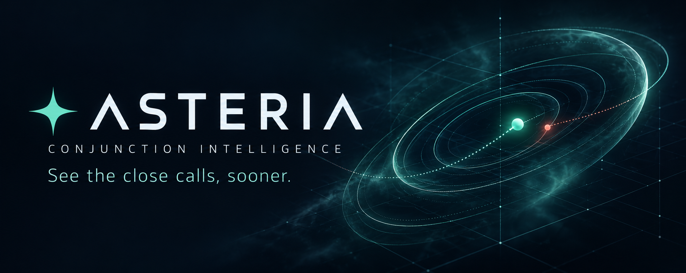

# Asteria: conjunction intelligence

An interactive prototype for Airbus Challenge 1: predict an event's **final recorded risk tier from a message available at least two days before closest approach**. Explore historical conjunction messages, rotate the relative encounter view, replay the evidence, and record an analyst review.

**[Watch the 30-second interface showcase](assets/asteria-showcase-30s.mp4)**

Refreshed from the updated live app on 31 October: actual 3D rotation, all 13 early-message replay states, final-tier probabilities and current held-out evaluation. The banner and video are stored in this private repository alongside the source.

## Updated challenge contract

The [updated challenge brief](docs/airbus-challenge-updated.pdf), [organiser clarifications](docs/airbus-updates-summary.pdf), and [official event labels](docs/challenge1_event_labels.xlsx) define the current pipeline. The original train/test CSVs are unchanged; the updated dataset archive adds the event-label workbook.

- Each training example is the latest eligible CDM for one labelled event: the minimum time-to-TCA that is still **≥ 2 days**, with a stable source-row tie-break.
- The target is the workbook's final tier. Event IDs, recorded risk, and final-label fields are excluded from model inputs.
- A three-class classifier predicts Critical, Elevated or Safe. Its class probabilities are **uncalibrated model outputs, not physical collision probability (Pc)**.
- Events are split 60%/20%/20% into training, validation and holdout sets, stratified by final tier with seed 42. Model selection uses validation macro-F1, with Critical recall as the tie-break. The chosen model is refit on training plus validation events before one holdout evaluation.
- The train and test files have separate event-ID namespaces. Test events are not joined to training outcomes, and the test demonstration has no official final outcomes.

The workbook contains **13,154** final-tier labels. **11,942** events have an eligible early message: **834 Critical, 2,162 Elevated and 8,946 Safe**. The remaining **1,212** events are excluded from supervised training and evaluation because no message is available at least two days before TCA.

“Final” means the last recorded message in the supplied history, not a verified collision outcome. The official final rows include **389 negative time-to-TCA values**; **3,050 events** still have their final recorded message at least two days before TCA. The dashboard does not claim physical orbit propagation, collision truth, or operational readiness.

## Units and tier rules

The supplied time-to-TCA values are in **days**, miss distances and relative-position components are in **metres**, relative speed is **m/s**, and recorded risk is **log10(Pc)**. A value of −30 represents an approximately zero probability floor. The original unit conversions were already correct.

The challenge's rule precedence is:

| Tier | Recorded-message condition |
|---|---|
| Critical | log10(Pc) ≥ −4 **or** miss distance < 1,000 m |
| Elevated | Otherwise, log10(Pc) ≥ −6 **or** miss distance ≤ 5,000 m |
| Safe | log10(Pc) < −6 **and** miss distance > 5,000 m |

Exactly 1,000 m does not meet the distance-only Critical condition; exactly 5,000 m still meets Elevated. Recorded-message rule evidence is separate from the model's predicted final tier.

## Run the MVP

The stack remains **Python 3.12, Streamlit, Plotly, pandas and scikit-learn**, with SQLite for analyst reviews. From the project directory in PowerShell:

    & ./.venv312/Scripts/python.exe -m streamlit run app.py

Open the local URL Streamlit prints. The app uses the precomputed artifacts bundle; raw train/test CSVs are not needed merely to run that bundle.

To rebuild the model and reports from the supplied files:

    & ./.venv312/Scripts/python.exe train.py --train "Challenge 1 Airbus_/train_data.csv" --test "Challenge 1 Airbus_/test_data.csv" --labels "docs/challenge1_event_labels.xlsx"

On another machine, create a Python 3.12 virtual environment and install requirements.txt. Then run the training script and Streamlit with that environment's Python. Run the training script with --help for path overrides. The default label path is docs/challenge1_event_labels.xlsx.

## Explore the app

1. Open **Mission control**, choose a dataset, filter the event queue, and select an event. Predicted final tiers and model class probabilities describe the early forecast; recorded telemetry describes the selected message; deterministic rules define the official final labels.
2. Rotate the 3D encounter view and move the replay slider. The view shows relative encounter geometry and distance guides, not a propagated orbit. Replay can inspect multiple eligible messages; headline model metrics still count each holdout event once.
3. Open message evidence and the assessment PDF to inspect source values, rules, data-quality flags and limitations. A guided tour points to the controls and charts.
4. Open **Model evidence** for current event-level metrics, class denominators, the confusion matrix and actual errors. The refreshed showcase uses this same final-tier model and evaluation.
5. Download predictions, upload a telemetry CSV, or record an analyst review with a reason. Reviews document a human assessment; they do not authorize a maneuver.

Uploads need an event ID and all 12 permitted telemetry features. Any recorded risk or final-outcome columns are ignored at inference. Predictions preserve every input row: rows with missing time-to-TCA or time-to-TCA below two days receive an ineligible forecast status, an Incomplete tier, and no class probabilities. Eligible replay rows can receive forecasts, but do not become extra evaluation events.

Choose the event-level download for one latest eligible forecast per event, or the all-row download for message replay and inspection. Spreadsheet-safe downloads escape formula-like text; separate exact CSVs preserve identifiers for machine use. Hosted uploads are processed by the app's server. Local review records are stored in artifacts/analyst_decisions.sqlite; shared cloud storage may be ephemeral and is not a tamper-evident audit system.

## Current evaluation

The split contains **7,165 training, 2,388 validation and 2,389 holdout events**. A balanced HistGradientBoostingClassifier was selected on validation macro-F1 (0.8790 versus 0.8736 for the unweighted candidate).

| Holdout measure, one example per event | Final-tier classifier | Distance-only baseline |
|---|---:|---:|
| Accuracy | 93.01% | 93.22% |
| Macro-F1 | 0.8708 | 0.8717 |
| Critical precision | 79.89% | 81.98% |
| Critical recall | 85.63% | 84.43% |

The classifier detects **143 of 167 Critical events**, misses **24**, and raises **36 false Critical alarms**. It does **not** outperform the distance-only baseline overall: its small Critical-recall gain trades against precision. Class probabilities are uncalibrated. The generated metrics in artifacts/metrics.json and the live Model evidence screen are the source of truth after future rebuilds.

The dataset was explored during earlier development. Event separation prevents overlap between the current training and holdout partitions, but these results are not an independent operational validation or evidence of real-world class prevalence. The test demonstration is unlabelled for this target.

Earlier same-message regression, probability-driven subset, conformal-interval and supplemental-classifier studies under experiments/ are **archived experiments for an obsolete target**. Their scores do not evaluate the current final-tier classifier and must not be used as current product claims.

The checksum manifest detects bundle changes; it does not establish data lineage. Historical time buckets contain separate event snapshots and are not a synchronized live forecast. Independent data, organiser scoring and further validation are required before any operational use. The analyst retains decision authority.

## Checks and deployment

Run the project checks after rebuilding:

    & ./.venv312/Scripts/python.exe -m pytest -q

Relevant checks cover the two-day cutoff, event separation, source-specific IDs, target leakage, units and boundary rules, inference/export behavior, artifact consistency and report generation.

Deployment uses Streamlit Community Cloud backed by the private GitHub repository. The local deployment checkout is tmp/asteria-private-deploy. Sync the reviewed source, documentation, media and regenerated artifacts together, commit and push there, then verify the hosted app's model target and artifact status after its rebuild. Keeping the repository private protects the source; live-app access is controlled separately in Streamlit.
